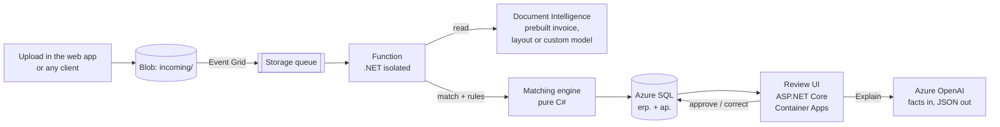

# Three-Way Match Copilot

[](https://github.com/chris-loog/three-way-match-copilot/actions/workflows/ci.yml)


Reads supplier invoices and delivery notes with Azure AI Document Intelligence, matches them against purchase orders and goods receipts in an ERP-style Azure SQL database, approves the clean ones automatically, and sends the rest to a review screen where a language model explains what is wrong. Built for the purchasing team of a manufacturer that today compares every document by hand.

**Live demo:** <!-- DEMO-LINK --> added after the first deploy. The site scales to zero, so the first request waits a few seconds for a cold start. It runs in demo mode (a fixed reviewer, sample data only).

Everything here is synthetic. The company, the suppliers and the documents are fictional.

## The result in four numbers

Evaluated on the dev split (179 documents: 124 clean, 20 light scans, 15 heavy scans, 20 photos), with Document Intelligence reading every file.

| | |
|---|---|
| **Wrong automatic approvals** | **0 of 39** documents with a real problem |
| **Straight-through rate** | 65.9 % overall (118 of 179). 96 of 98 clean documents (98 %). Heavy scans and photos mostly go to a person, on purpose. |
| **Field accuracy, clean documents** | 100 % on every checked invoice and delivery-note field (66 invoices, 58 delivery notes) |
| **Cost** | About 2 US cents per document all in: 1.95 to read, 0.08 for an explanation when one is needed (list prices, see `eval/evaluation.ipynb`) |

**Test split (79 documents, one run, including a supplier layout the system never saw):** 0 wrong automatic approvals out of 22 documents with a real problem; 44 of 79 straight through (55.7 %); 13 of 57 good documents sent to a person (22.8 %). Details, charts and the honest limits are under [Results](#results).

## The problem

A purchasing team receives about 40 supplier documents a week. For each invoice an accountant finds the purchase order, checks that the goods arrived, compares quantities, prices, units, totals and the bank account, and decides whether to pay. This is the **three-way match**: purchase order (what we ordered), goods receipt or delivery note (what arrived), invoice (what we are charged).

Most invoices are fine. The few that are not cost real money: billed twice, billed for goods that never arrived, a price above the order, a changed bank account that turns out to be fraud. The system has one job that matters: **never approve something that should have been stopped**, and approve as much of the rest as it safely can.

## How it works



1. **Upload.** A file lands in `incoming/invoices/` or `incoming/delivery-notes/`. Event Grid puts a message on a storage queue, so it works the same locally and in Azure, with built-in retries and a poison queue.
2. **Read.** Invoices go to the prebuilt invoice model. Delivery notes go to a custom model, or to the layout model with simple rules until that exists (the model id is a setting). Every raw result is stored, so mapping can be re-run without calling Azure again.
3. **Check what was read.** Our own parse of the printed text must agree with the model's value; IBANs are checked against their checksum; the invoice must add up (quantity x price = line, lines = net, net + VAT = gross). A shaky field that the arithmetic or the ERP confirms is not a reason for doubt, and a misread amount never reconciles.
4. **Match.** Supplier by VAT number; purchase order by reference; each line by supplier item code, then our item code, then wording we learned from reviewers, then fuzzy wording (a guess, which always forces review). Units convert only through the supplier's item data: solid cubic metres and stacked cubic metres are never converted.
5. **Decide.** Thirteen rules look for discrepancies. The decision is code, not a model: *rejected* (exact duplicate), *on hold* (goods not fully received yet), *needs review* (any warning, block or guess), *auto-approved* (nothing found).
6. **Review.** A person sees the document next to what was read, the order and the receipt, and approves or corrects. A human decision is never overwritten by a machine re-run. Corrections are stored and re-applied on top of the stored result, so a correction re-matches without calling Azure.
7. **Explain.** On request, a language model writes a short explanation and, where it is safe, a draft message to the supplier in Estonian or English. It gets structured facts, never the document text, and its answer must pass checks in plain code. For a changed bank account and for goods that have not arrived yet, no supplier message is drafted; the reviewer gets fixed text instead (phone the supplier on the number in the master data; wait for the goods).

### Discrepancies it catches

| Code | Rule |
|---|---|
| `QTY_OVER_INVOICED` | Billed more than received and not yet billed. A Block above a configurable amount. |
| `PRICE_ABOVE_PO` | Unit price above the order price plus tolerance. A Block above a configurable amount. |
| `ITEM_NOT_ON_PO` | An invoice line matches no order line |
| `NO_PO_REFERENCE` | The order number is missing or unknown |
| `DUPLICATE_INVOICE` | The same file, or the same supplier and invoice number, again |
| `POSSIBLE_DUPLICATE` | Same supplier and amount within 14 days under a different number |
| `TOTALS_MISMATCH` | Lines plus VAT do not equal the total |
| `BANK_ACCOUNT_CHANGED` | A valid IBAN that differs from the supplier master data (the fraud signal). An invalid checksum is treated as a misread instead. |
| `DELIVERY_NOTE_MISMATCH` | The supplier's note says one quantity, the warehouse booked another |
| `UOM_MISMATCH` | The unit differs and cannot be converted |
| `PARTIAL_DELIVERY` | The invoice arrived before all goods did. The document goes on hold and is re-checked daily. |
| `PRICE_BELOW_PO` | Unit price below the order price (information only) |
| `LOW_CONFIDENCE` | A key field was read with too little confidence |

## Results

Produced by one command, `dotnet run --project tools/DocGen -- eval`, which runs every dataset document through the same extraction, matching and rule code as the pipeline. The notebook [`eval/evaluation.ipynb`](eval/evaluation.ipynb) turns its output into the tables and charts. The scoring rule: a doubtful document sent to a person is **correct**; the only failure is a wrong automatic approval.

**Dev split, delivery notes read by the layout model and rules** (document accuracy per field; photos and scans are simulated, five real photos are in the test split):

| Documents | n | Invoice number | Net total | VAT total | Delivery-note number | Delivery date | Quantities |
|---|---|---|---|---|---|---|---|
| Clean | 66 / 58 | 100 % | 100 % | 100 % | 100 % | 100 % | 100 % |
| Light scan | 11 / 9 | 100 % | 100 % | 100 % | 100 % | 100 % | 100 % |
| Heavy scan | 4 / 11 | 100 % | 75 % | 100 % | 82 % | 73 % | 64 % |
| Photo | 13 / 7 | 85 % | 100 % | 92 % | 86 % | 71 % | 86 % |

(n is invoices / delivery notes. Every other invoice field, PO reference, VAT number, date, gross total, IBAN and line count, is 100 % in all four rows. Heavy scans are the weak spot, and that is where the confidence check sends documents to a person.)

| | Result on dev |
|---|---|
| Invoice lines matched to the correct order line | 256 of 257 |
| Injected discrepancies caught (12 codes, 61 documents) | Offline with perfect reading: 69 of 69. With real reading on dev: every code except 2 of 10 delivery-note mismatches; both are photos, and both still went to review as hard to read. |
| Decisions as expected | 156 of 179. The other 23 are good documents sent to review (22) and one on-hold document sent to review. |
| Confidence threshold | Flat from 0.60 to 0.90 (118 approved, 0 wrong); at 0.95 only 68 are approved. Kept at 0.80. |

**What fixing the first run taught.** The first dev run sent 50 of 140 good documents to review. Three real read errors caused most of them: the OCR writes `no .:` with a space before the dot, it reads the superscript of m³ as `ª` on scans, and the prebuilt invoice model sometimes leaves the order number out although it is printed. After fixing those (each with a test) it was 22. The rest are heavy scans and photos.

**Test split, run once** (79 documents: 42 invoices and 37 delivery notes, 27 of them from the layout the system never saw; delivery notes read by the custom neural model, the default):

| | Test result |
|---|---|
| Wrong automatic approvals | **0 of 22** documents with a real problem |
| Straight through | 44 of 79 (55.7 %); dev was 67.0 % |
| Good documents sent to a person | 13 of 57 (22.8 %): 3 clean, 4 photos, 1 real photo, 4 heavy scans, 1 light scan |
| Decisions as expected | 82.3 % (dev 88.3 %) |
| Invoices on the held-out layout | 12 of 14 decisions correct |

The test split is lower than dev on straight-through rate. Part of it is the unseen layout (5 of the 13 false alarms are on it: 4 delivery notes, 1 invoice) and part is photos and heavy scans (9 of the 13). A document sent to a person is the safe outcome, so the zero in the first row is the number that matters.

**Delivery-note readers compared on the test split** (mean accuracy over number, PO reference, VAT number, date, line count and quantities):

| Reader | Known layouts (24 notes) | Held-out layout (13 notes) | Wrong auto-approvals | Good notes sent to review |
|---|---|---|---|---|
| `prebuilt-layout` + rules | 100 % | 97 % | 0 | 5 |
| Neural model (default) | 99 % | 94 % | 0 | 7 |
| Template model | 98 % | 74 % | **2** | 7 |

- The **template model** failed on the unseen layout: it read the delivery date correctly in none of the 13 notes, and quantities in 69 %. Two notes with a wrong quantity were read with a confidence of 0.99 and approved. A fixed-layout model is confident exactly where it should not be.
- The **neural model** generalised better (quantities 77 % on the held-out layout), and none of its misreads led to a wrong approval on this test set.
- The plain **layout model with rules scored best on test**, slightly better than the trained neural model. It needs no labelling or training. The neural model stays the default because it was the model chosen on dev, and the test split was not used to change the choice. With 13 notes on the held-out layout the difference is two or three documents; it is a signal, not a proof. Picking the layout reader would be a documented "v2" decision.

**Processing time**, from the real pipeline (17 invoices uploaded to Blob Storage, queue, Function running locally against Azure SQL): median 8.5 s, p95 10.2 s, slowest 13.7 s (the first one, with the database waking from auto-pause). Most of it is the extraction step. The deployed Function has not been timed yet.

**Explanations, scored on 10 documents** by Claude from the text (not by a human; the PDFs were not opened), 1 to 5:

| | Correct | Useful | Safe to send |
|---|---|---|---|
| v1 (the model writes the whole letter) | 4.0 | 3.5 | 2.5 |
| v2 (fixed meaning per code, letter frame written in code) | 4.6 | 4.1 | 4.7 |

What v1 got wrong: it explained a partial delivery as over-delivery, it drafted bank-change letters that ask the sender to confirm by reply (the channel a fraudster controls), it mangled supplier names (`ÖC`) and left placeholders (`[Teie nimi]`). v2 sends each finding's meaning with the facts, writes the greeting, the supplier's name and the closing in code, and drafts nothing for a bank change or a partial delivery. In the v2 run 15 of 16 answers came from the model; one fell back to the template text after the model twice left out the blocking code, which is the guard doing its job.

### Honest limits

- The data is synthetic: five layouts, one fictional company, and errors injected by the same person who wrote the rules. Recall on injected errors is partly circular; the scans, the photos and the held-out layout are the honest part.
- 179 dev documents are few. A single document moves a percentage by several points, which is why counts sit next to percentages.
- The threshold was chosen on dev. The test split was run once; any later run is reported as v2.
- The explanation scores are one reader's judgement on 10 documents, not a measured accuracy.
- Duplicate checks only know the documents the system has already processed. A possible duplicate of an invoice it never saw is approved if nothing else is wrong.
- The results show the method, not performance in a real plant.

## Security

- **No secrets anywhere.** Every Azure service is reached with a managed identity (`DefaultAzureCredential`); GitHub deploys with OIDC. There is nothing to leak or rotate, and no Key Vault is needed.
- **The running app cannot change the database schema.** Its identity can read and write data only. Migrations are an EF Core bundle that an administrator applies; the deploy workflow builds it but never runs it.
- **Prompt injection.** A supplier controls the text of a line description. The model never sees document text, only a JSON object of facts built from the database. Line descriptions are the one free-text field: stripped of control characters, cut to 60 characters, sent as a data value and labelled as data. The model has no tools and makes no decision, so there is nothing for an injected instruction to take over.
- **The model cannot make things up unnoticed.** Every number in an answer must appear in the facts, every code must be one of the findings, and every blocking finding must be named. A failing answer is retried once, then replaced by fixed template text built from the facts.
- **Keyless document preview.** The review page links to the blob with a user-delegation SAS: signed by Entra ID, read-only, valid for five minutes.
- **Public demo limits.** Demo mode uses a fixed reviewer, so it only ever holds synthetic data. Uploads are rate limited per address and capped at 10 MB, and the explain button is throttled.
- **Fraud signals are rules, not afterthoughts.** A changed bank account needs a "verified by phone" confirmation before anyone can approve it.

## Design decisions

The short list; [`docs/decisions.md`](docs/decisions.md) has the alternatives and the reasoning.

- **The matching engine is a pure function over plain data.** It receives a snapshot and returns an outcome; it never queries. Every rule is tested with a hand-built mini-ERP in milliseconds, and the same code runs in the pipeline and in the evaluation.
- **A guess never approves a payment.** Fuzzy supplier names, fuzzy line wording and "the only open order that fits" are useful and always produce a concern that forces review.
- **The model explains and never decides.** Approve or reject comes from rules that can be tested and audited.
- **Idempotency by blob path, not by file hash.** A retried queue message finds its row and resumes; a resent file under a new name becomes its own row and is rejected as a duplicate.
- **Every stage is saved and skippable.** A crash or a redelivered message resumes where it stopped. Temporary failures (service busy) are retried by the queue; permanent ones (a corrupt file) end as `Failed` with the error visible.
- **The audit trail is the database.** Temporal tables keep every earlier version of a decision and of a reviewer's override.
- **Test-split discipline is in the code.** The evaluation only lets Document Intelligence read the chosen split; the rest is read as printed text so the shared state stays complete.

## Run it

<details>
<summary>Prerequisites and local setup</summary>

You need the .NET 10 SDK, an Azure subscription, Python 3.12 (for the evaluation notebook) and Docker (for the image).

```bash
git clone https://github.com/chris-loog/three-way-match-copilot.git
cd three-way-match-copilot
dotnet build
dotnet test                       # no Azure needed: Azure is faked in every test
```

**Azure resources.** `infra/setup.sh` is the CLI record of the base resources (resource group, storage, Event Grid, SQL, Document Intelligence, Azure OpenAI, monitoring). `infra/setup-phase9.sh` creates the deploy resources. Both are written to be read first and run in parts.

**Database.** Entra-only authentication, no SQL password:

```bash
export THREEWAYMATCH_SQL="Server=tcp:<server>.database.windows.net,1433;Database=sqldb-three-way-match;Authentication=Active Directory Default;Encrypt=True"
dotnet dotnet-ef database update -p src/ThreeWayMatch.Infrastructure -s src/ThreeWayMatch.Infrastructure
dotnet run --project tools/DocGen -- seed           # the fictional ERP: suppliers, items, orders, receipts
```

**Documents.**

```bash
dotnet run --project tools/DocGen -- generate       # 258 PDFs with ground truth and a manifest
python3 -m venv .venv && .venv/bin/pip install -r requirements.txt
.venv/bin/python tools/degrade/degrade.py           # turns some into scans and photos
dotnet run --project tools/DocGen -- check-rules    # offline: rules against ground truth, no Azure
```

**The web app and the Function.**

```bash
export THREEWAYMATCH_SQL=...   Storage__BlobServiceUri=https://<storage>.blob.core.windows.net   OpenAI__Endpoint=https://<openai>.openai.azure.com/
dotnet run --project src/ThreeWayMatch.Web          # Development turns demo mode on
cd src/ThreeWayMatch.Functions && cp local.settings.sample.json local.settings.json   # fill in, then: func start
```

**Evaluation.** See [`eval/README.md`](eval/README.md). **Deploying.** See [`docs/deploy.md`](docs/deploy.md).

</details>

## Tests and CI

- About 490 xUnit tests, none of which calls Azure. The domain tests cover each rule and the matching engine; one test runs the whole judgement over all 258 generated documents and fails if anything with a real problem is approved automatically. Pipeline and web tests use an in-memory database, a fake extractor and a fake language model, and the web tests render real pages through `WebApplicationFactory`.
- The invoice mapper tests run on a saved real Document Intelligence result.
- GitHub Actions builds and tests on every push to `main` (warnings are errors). A second workflow deploys after CI is green: OIDC login, image tagged with the commit, Container App and Function updated, then a smoke test against `/health`, which checks the database (and that every migration is applied), storage and the queue.

## Repository layout

```
src/ThreeWayMatch.Domain/          entities, rules, matching engine, explanation guards (no Azure dependencies)
src/ThreeWayMatch.Infrastructure/  EF Core model and migrations, Document Intelligence and OpenAI clients, pipeline
src/ThreeWayMatch.Functions/       queue-triggered processing, daily re-check of documents on hold
src/ThreeWayMatch.Web/             ASP.NET Core Razor Pages review UI and /health
tests/ThreeWayMatch.Domain.Tests/  xUnit
tools/DocGen/                      seed, generate, check-rules, extract, eval, explain
tools/degrade/                     Python: turns clean PDFs into scans and photos
eval/                              evaluation notebook and run instructions
infra/, db/                        Azure CLI scripts, SQL for the identity grant, schema
```

## Why this matters

Purchase-to-pay matching is where an ERP meets paper. I have worked with Monitor ERP integrations and built an ERP for a scrap-metal company, and the rules here come from that kind of work: partial deliveries are the normal case, units are the quiet source of errors, and a bank-account change is the invoice you must never wave through. The point of the project is to show that document AI can take the routine work out of that process without taking the control away from the people responsible for it.

## Limitations and next steps

- One fictional company, five layouts, synthetic documents. No e-invoice XML (a structured invoice needs no OCR and should be the first intake path).
- A mock ERP in SQL. A real deployment needs an adapter for the actual ERP's purchase orders and receipts.
- A shared demo reviewer. Real use needs the Entra ID sign-in with a Reviewer role (wired in, not yet tested against a tenant) and four-eyes approval above a set amount.
- Reviewer corrections apply to invoices; delivery notes are read-only for now.
- More layouts, and a retraining loop from the stored corrections.

## Licence and data

The documents, suppliers, prices and bank accounts are generated. Bank account numbers use an unassigned bank code with a valid checksum, so no generated account can be real. No data from any employer or client was used.
