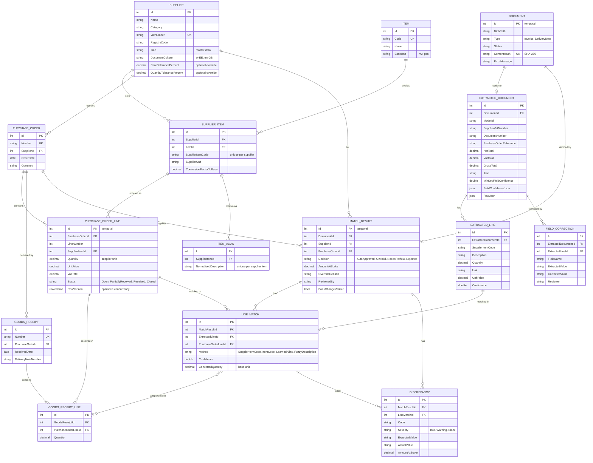

# ER diagram

Two SQL schemas. `erp.` is the mock ERP (purchasing and warehouse). `ap.` is the application (documents, extraction, matching, review).
Tables marked *temporal* keep every earlier version of a row in a history table, which is the audit trail.

## Notes

- **Units.** `Item.BaseUnit` is what the warehouse counts in. A PO line is stored in the supplier's unit, exactly as on the supplier's paperwork. The matching engine multiplies by `SupplierItem.ConversionFactorToBase` before it compares anything.
- **Partial deliveries.** A PO line has many `GoodsReceiptLine` rows, one per delivery. Received quantity is their sum.
- **Audit trail.** `Document`, `MatchResult` and `PurchaseOrderLine` are temporal tables. `SELECT ... FOR SYSTEM_TIME ALL` shows every earlier version and when it changed.
- **Learned aliases** live in `ap.ItemAlias` and point at `erp.SupplierItem`, so the app never writes to the ERP tables.
- **Deletes.** Foreign keys do not cascade except where a parent owns its children (PO → lines, receipt → lines, document → extraction and match result, match result → line matches and findings).
